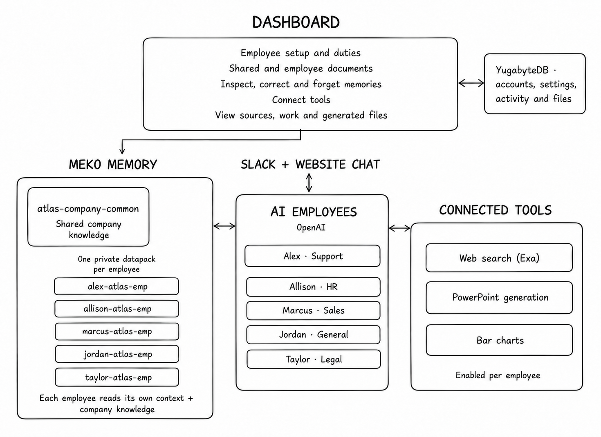

# OpenHuman

**An actionable datapack orchestrator built on Meko, for solopreneurs and companies building an AI team.**

OpenHuman turns company knowledge into AI coworkers that work alongside you in Slack. A **datapack** is Meko's container for conversations, memories and documents. Each coworker gets a private one, along with a role, instructions and connected tools. One common company datapack gives the whole team shared context.

Meko gives these coworkers continuity: a support fix, company decision or customer preference can inform the next task. OpenHuman connects that memory to useful work—answering customers, researching prospects and creating presentations. As the team works, a shared chat router sends new context to the right datapacks, and Meko extracts facts employees can recall later.

Built by **tungtungtungsahur** for **hackCBS 9.0 · Meko Track A**.

## Architecture



Example layout for Atlas. Each employee reads its own context and the common company datapack; private employee datapacks are created during onboarding.

## What you can build

- **Customer support:** give Alex product guides and runbooks so he can explain the right fix, find the escalation owner and draft a customer reply.
- **HR:** give Allison the company handbook and private leave records so she can answer policy questions and check remaining leave.
- **Sales:** give Marcus your product brief so he can research prospects and turn the findings into a presentation.

## What you can do

- Give each employee the documents relevant to their job.
- Talk through Slack mentions, direct messages and threads, or use **Chat** on the website.
- Inspect recalled sources and saved memories; add, correct or forget a fact.
- Connect web search, PowerPoint generation and bar charts. Review the results and download generated files from the website.

## Setup in five steps

You need **Git, Python 3, Docker with Compose**, an **OpenAI API key** and a **Meko API key** with available quota.

1. **Clone the repository.**

   ```sh
   git clone https://github.com/snowsadh/meko.git
   cd meko
   ```

2. **Prepare local settings.** This creates `.env` and generates the application's signing and encryption keys.

   ```sh
   python3 scripts/setup.py
   ```

3. **Add your service keys** to `.env`.

   ```dotenv
   OPENAI_API_KEY=your-openai-key
   MEKO_PRODUCT_API_KEY=your-meko-key
   ```

4. **Start the app.** Docker runs the website, backend and YugabyteDB, and applies database migrations. The first build can take a few minutes.

   ```sh
   docker compose up --build -d
   ```

5. **Open [localhost:3000](http://localhost:3000)** and create an account. Set up a company, optionally add shared documents, and onboard an employee. Open the employee's **Work and context → Chat** to send a message.

Website chat works without Slack. To use employees in your workspace, follow the [Slack setup guide](docs/setup.md#slack-setup), connect the employee from its page, and invite it to a channel. It starts listening automatically.

## How it works

Company setup comes first: add shared documents, then onboard employees from job templates and give each one its own instructions and documents. When a message arrives, the employee retrieves relevant company knowledge and its private context before OpenAI prepares the reply or calls an enabled tool.

For new Slack conversations, a shared router asks OpenAI where each chat chunk belongs: company knowledge, selected employees, both, or neither. Meko extracts durable facts from conversations accepted into employee memory. The website shows sources, routing decisions and save status.

| Service | Responsibility |
| --- | --- |
| **Meko** | Employee memory, shared company knowledge and document retrieval |
| **OpenAI** | Replies, chat routing and tool-call decisions |
| **YugabyteDB** | Accounts, employee settings, activity and generated files |

## Try the memory difference

The [sample onboarding documents](docs/onboarding/) describe a fictional company, Atlas. Upload the company handbook as shared knowledge and Alex's support playbook to Alex. Wait for indexing to finish, then ask:

> An Enterprise customer sees AMBER-217 when signing into Atlas. Who handles it, what should they do, and should we reset the password?

In **Work and context → Chat**, send the same question with **Use saved knowledge** off, then on. Compare the answer and **Context used**. The playbook names Isha in Access Ops and the specific fix. Keep connected tools off for this comparison.

This switch applies to website chat; Slack continues to use saved knowledge.

## Further reading

- [Slack setup, available tools and development checks](docs/setup.md)
- [Architecture and verification notes](docs/architecture.md)
- [Meko feature proposal: sharing selected memories between datapacks](docs/meko-feature-proposal.docx)
- [Challenge requirements](requirements.md)
